# PO, GRN and Price Variation Analysis using SQL and Python

**PO = Purchase Order, GRN = Goods Receipt Note**

SQL and pandas analysis of purchase orders, goods receipts and price variations to find receiving errors, cost price changes, negative margins and supplier delays.

## Dataset
- Data: anonymized data based on a hypermarket purchase and inventory system.
- The repository contains queries, scripts and result screenshots only, no data files.
- Database: SQL Server
- Tools: SQL and Python (pandas)

## Key assumptions
- All quantities are converted to **base units** using the pack conversion (`um_units`), so cartons and pieces compare correctly.
- Free quantity (FOC) is included on both the PO and GRN sides.

**Logic:**
- Ordered qty = (PO qty + free qty) x pack units
- Received qty = GRN qty x pack units + FOC qty
- All GRNs of a PO are added together, so partial deliveries are compared correctly

## 01. GRN received more or less than PO qty

**Business impact:** Flags over-receipts (overpayment risk) and short receipts (stock-outs, supplier fill problems).

## Schema diagram

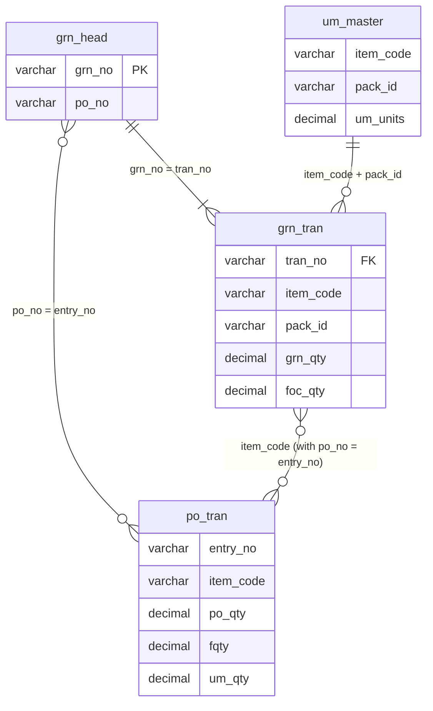
Only the tables and columns used by "GRN received more or less than PO qty" are shown.
---

### SQL

**Query:** [01_grn_qty_mismatch.sql](queries/01_grn_qty_mismatch.sql)

**Result:**

### pandas

**Script:** [01_grn_qty_mismatch.py](pandas/01_grn_qty_mismatch.py)

**Result:**

Top 15 rows shown, sorted by largest difference. Total: 16,632 PO-item rows compared. The pandas result matches the SQL result (same row count and same Exact, Short and Over counts).

---

## 02. POs with no GRN (pending)

**Business impact:** Shows orders placed but never received, so buyers can chase suppliers.

**Tables used:**

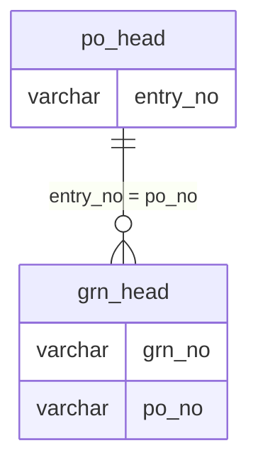

Only the tables and columns used by "POs with no GRN (pending)" are shown.

### SQL

**Query:** [02_pending_po.sql](queries/02_po_with_no_grn.sql)

**Result:**

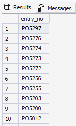

### pandas

**Script:** [02_pending_po.py](pandas/02_po_with_no_grn.py)

**Result:**

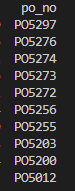

Top 10 rows shown. Total pending POs: 86. SQL and pandas counts match.

## 03. Same GRN entered twice

**Business impact:** Duplicate entries inflate stock and purchase value and can cause double payment.

**Logic:**
- Each item is totalled per GRN in base units: received qty = GRN qty x pack units + FOC qty
- Ordered qty = (PO qty + free qty) x pack units
- A PO item is flagged when it is received in **more than one GRN** and the **total received is more than the PO quantity**

**Tables used:**

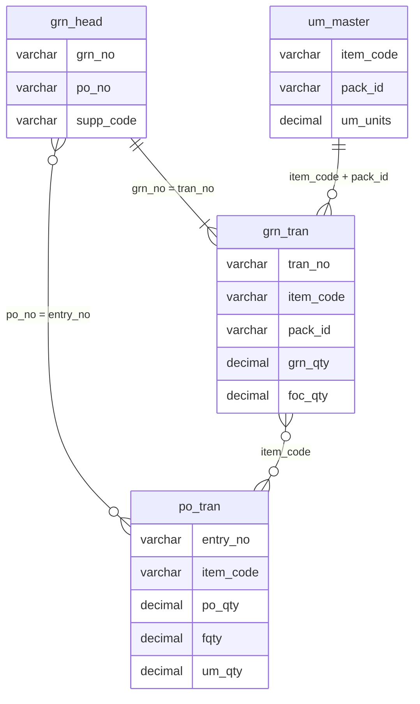

Only the tables and columns used by "Same GRN entered twice" are shown.

### SQL

**Query:** [03_duplicate_grn.sql](queries/03_duplicate_grn.sql)

**Result:**

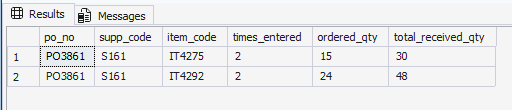

### pandas

**Script:** [03_duplicate_grn.py](pandas/03_duplicate_grn.py)

**Result:**

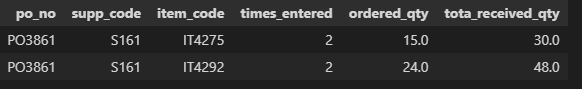

**Finding:** 1 PO with 2 items was received twice, so the total received was exactly double the ordered quantity.

---

## 04. Items whose cost price changed this month

**Business impact:** Shows cost changes early, so buyers can check margins and renegotiate.

**Logic:**
- Unit cost = GRN net amount / quantity in base units, per GRN and item
- Old cost = the item's last GRN cost before the month
- New cost = the item's latest GRN cost in the month
- Items where the two differ are listed, with the change and the % change

**Tables used:**

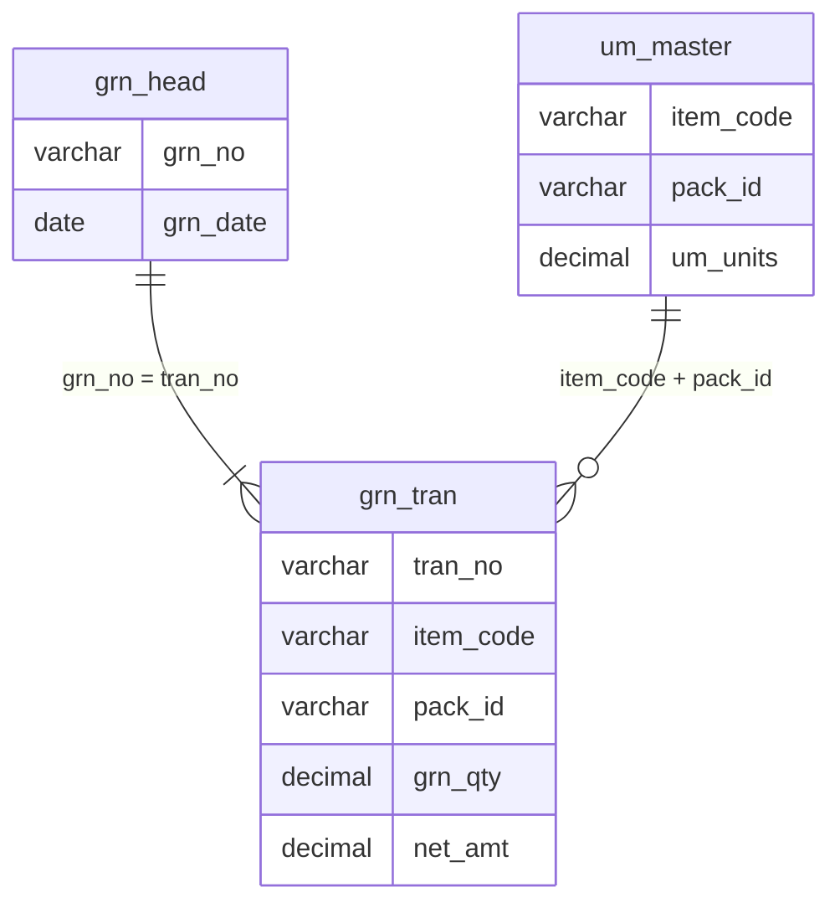

Only the tables and columns used by "Items whose cost price changed this month" are shown.

### SQL

**Query:** [04_price_change_month.sql](queries/04_price_change_month.sql)

**Result:**

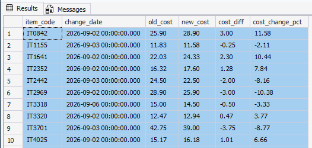

### pandas

**Script:** [04_price_change_month.py](pandas/04_price_change_month.py)

The screenshot shows a sample of the result

**Result:**

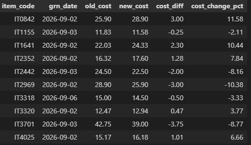

The screenshot shows a sample of the result

---

## 05. Price change history per item

**Business impact:** Shows how each item's cost moved over time, to spot repeated increases.

**Logic:**
- Unit cost = GRN net amount / quantity in base units, per GRN and item
- `LAG()` gives the previous cost of the same item
- The first cost of each item and every later change are listed

**Tables used:**

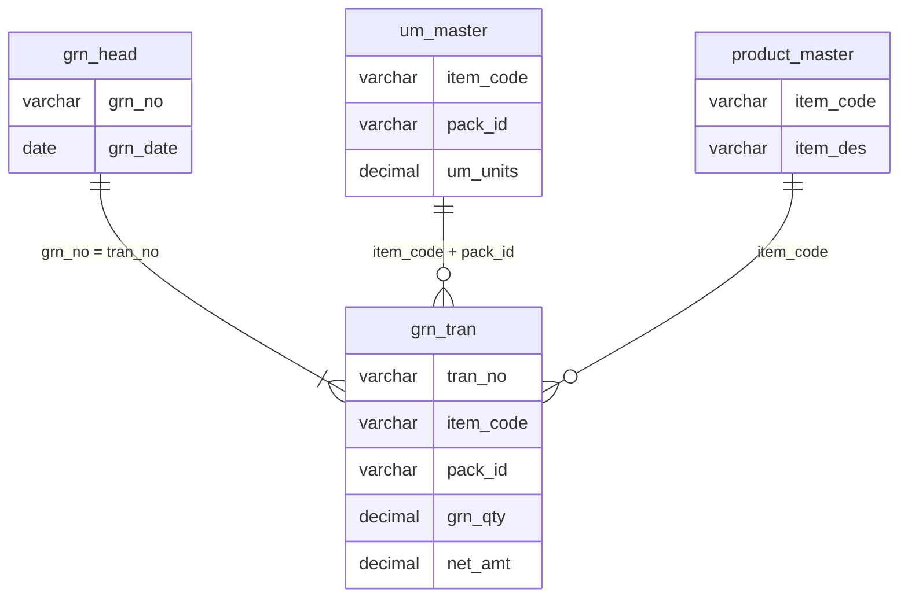

Only the tables and columns used by "Price change history per item" are shown.

### SQL

**Query:** [05_price_history.sql](queries/05_price_history.sql)

**Result:**

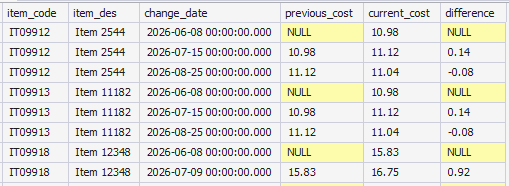

The screenshot shows only a sample of a few rows from the full result (more than 10,900 rows).

### pandas

**Script:** [05_price_history.py](pandas/05_price_history.py)

**Result:**

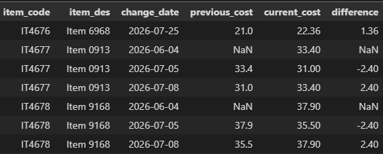

The screenshot shows only a sample of a few rows from the full result (more than 10,900 rows).

---

## 06. Selling price below cost (negative margin)

**Business impact:** Shows packs sold at a loss, so prices can be corrected before more margin is lost.

**Logic:**
- Pack cost = last net cost per base unit x pack units
- Compared with the retail price of the same pack
- A pack is listed when its cost is at least 0.01 above its retail price

**Tables used:**

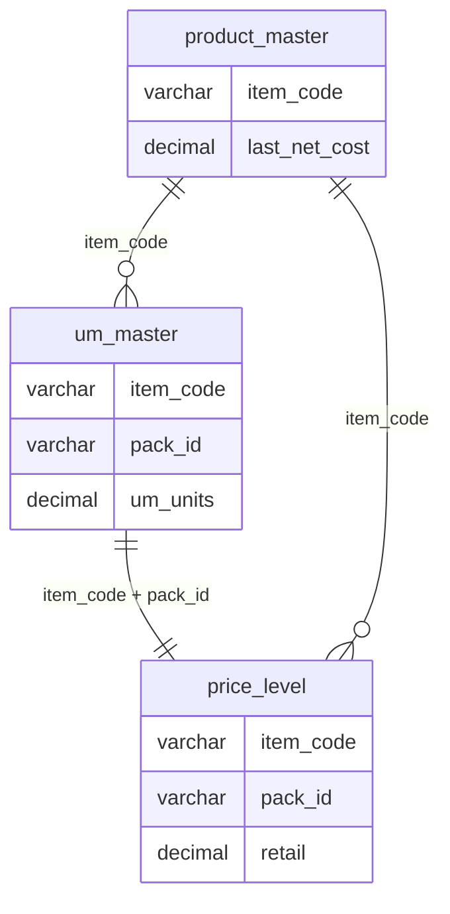

Only the tables and columns used by "Selling price below cost (negative margin)" are shown.

### SQL

**Query:** [06_negative_margin.sql](queries/06_negative_margin.sql)

**Result:**

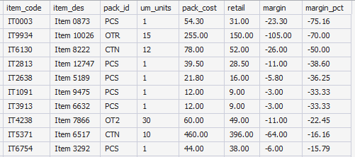

The screenshot shows only a sample of a few rows from the full result. The cost is the latest cost, not the cost when the price was set.

### pandas

**Script:** [06_negative_margin.py](pandas/06_negative_margin.py)

**Result:**

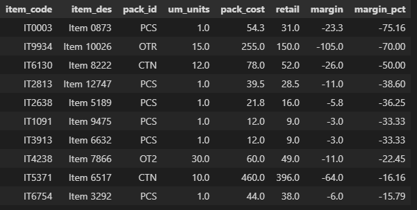

The screenshot shows only a sample of a few rows from the full result. The cost is the latest cost, not the cost when the price was set.

---

## 07. Supplier-wise delay and fill rate

**Business impact:** Shows which suppliers deliver late or short, so buyers can act on them.

**Logic:**
- Ordered qty = (PO qty + free qty) x pack units, per PO
- Received qty = GRN qty x pack units + FOC qty, summed over all GRNs of the PO
- As-of date is 31 August 2026
- **Late:** the last GRN came after the expected delivery date
- **On time:** the last GRN came on or before the expected date
- **Undelivered:** no GRN, and the expected date has passed
- **Pending:** no GRN, and not yet due
- Average delay covers late POs only
- Fill rate = total received / total ordered, including POs with no GRN

**Tables used:**

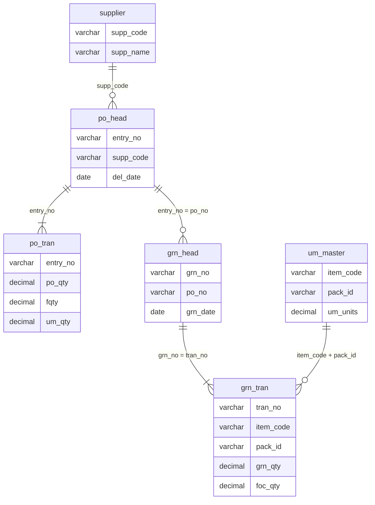

Only the tables and columns used by "Supplier-wise delay and fill rate" are shown.

### SQL

**Query:** [07_supplier_delay_fill_rate.sql](queries/07_supplier_delay_fill_rate.sql)

**Result:**

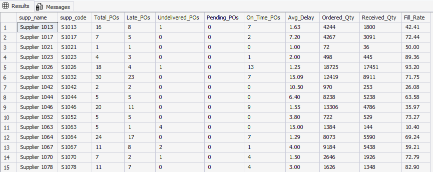

The screenshot shows only a sample of a few rows from the full result.

### pandas

**Script:** [07_supplier_delay_fill_rate.py](pandas/07_supplier_delay_fill_rate.py)

**Result:**

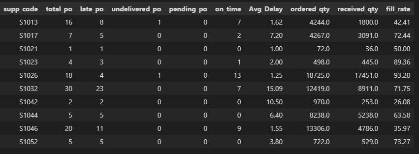

The screenshot shows only a sample of a few rows from the full result.

---

---

## 08. Top 10 suppliers by purchase value

**Business impact:** Shows where most spend sits, to focus negotiations and supplier reviews.

**Logic:**
- Purchase value = sum of GRN net amount per supplier
- `DENSE_RANK()` ranks suppliers by purchase value, and the top 10 are kept
- `share_pct` is the supplier's share of the total purchase value of all suppliers

**Tables used:**

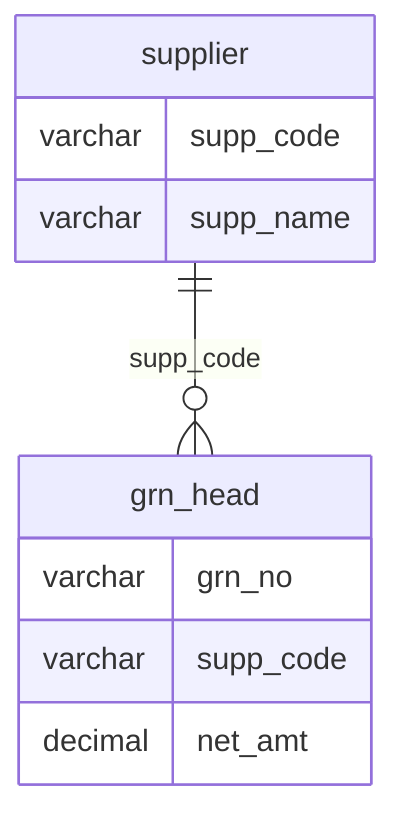

Only the tables and columns used by "Top 10 suppliers by purchase value" are shown.

### SQL

**Query:** [08_top10_suppliers.sql](queries/08_top10_suppliers.sql)

**Result:**

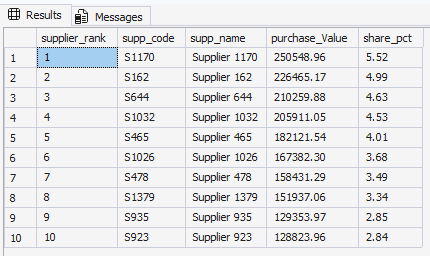

Purchase values are scaled by a constant factor.

### pandas

**Script:** [08_top10_suppliers.py](pandas/08_top10_suppliers.py)

**Result:**

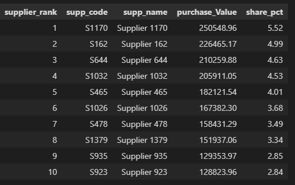

Purchase values are scaled by a constant factor.

---

## 09. Slow-moving items (estimated stock)

**Business impact:** Shows stock that is not selling, so it can be discounted or stopped from reordering.

**Logic:**
- Estimated stock = GRN received - POS sales, in base units
- An item is listed when its estimated stock is above 0, its last receipt is older than 30 days, and it had no sale in the last 30 days
- If an item has no sale, the idle days count from its last receipt
- As-of date is 31 August 2026
- POS sales of items with no GRN in the data period are ignored, because they cannot affect estimated stock

**Limits:** Stock is estimated, because no stock table was available. Opening stock, purchase returns, stock adjustments and sales returns are not included, so the result is indicative.

**Tables used:**

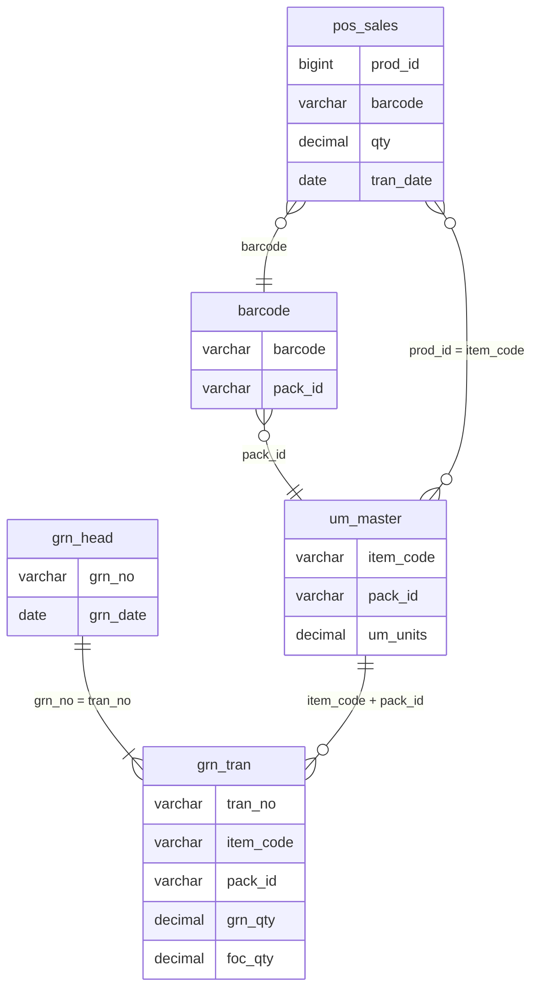

Only the tables and columns used by "Slow-moving items (estimated stock)" are shown.

### SQL

**Query:** [09_slow_moving_items.sql](queries/09_slow_moving_items.sql)

**Result:**

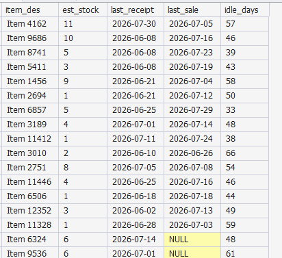

The screenshot shows only a sample of a few rows from the full result.

