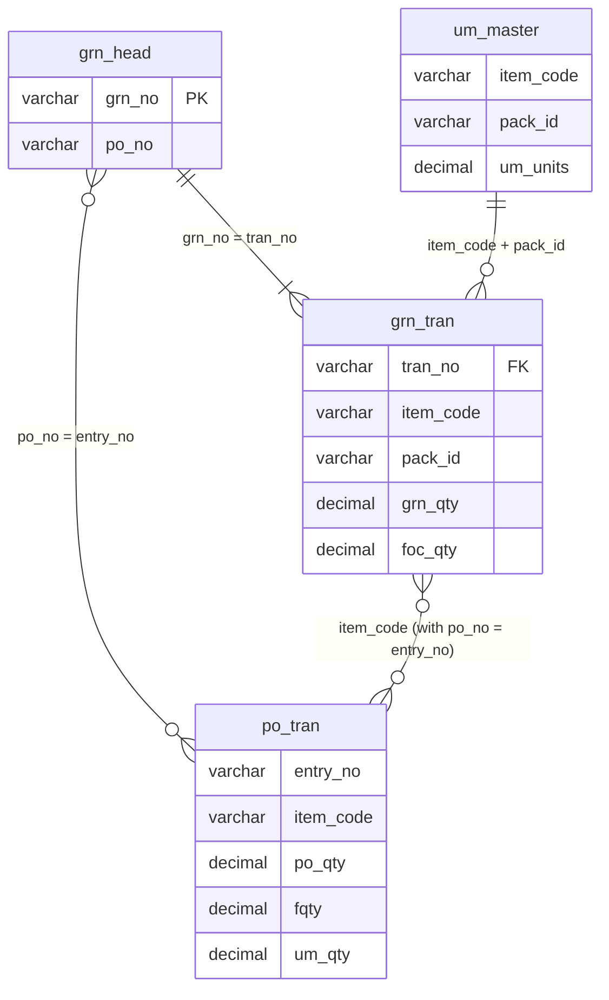
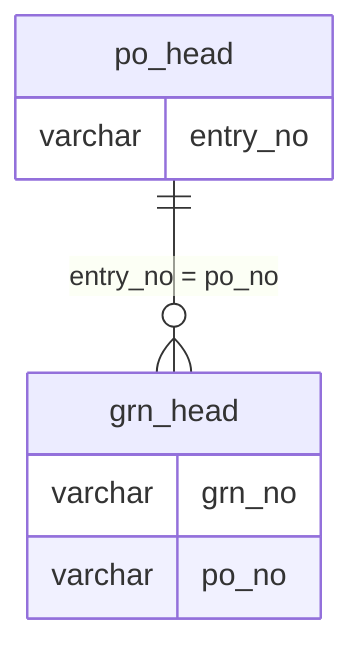
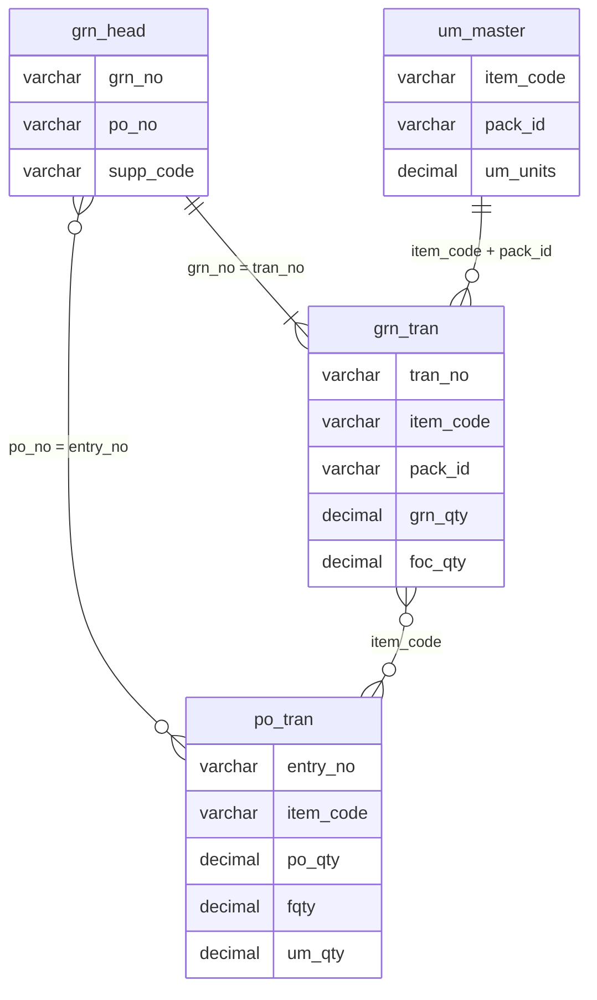

# PO, GRN and Price Variation Analysis using SQL and Python

**PO = Purchase Order, GRN = Goods Receipt Note**

SQL and pandas analysis of purchase orders, goods receipts and price variations to find receiving errors, cost price changes, negative margins and supplier delays.

## Dataset
- Data: anonymized data based on a hypermarket purchase and inventory system.
- The repository contains queries, scripts and result screenshots only, no data files.
- Database: SQL Server
- Tools: SQL and Python (pandas)

## Key assumptions
- All quantities are converted to **base units** using the pack conversion (`um_units`), so cartons and pieces compare correctly.
- Free quantity (FOC) is included on both the PO and GRN sides.

**Logic:**
- Ordered qty = (PO qty + free qty) x pack units
- Received qty = GRN qty x pack units + FOC qty
- All GRNs of a PO are added together, so partial deliveries are compared correctly

## 01. GRN received more or less than PO qty

**Business impact:** Flags over-receipts (overpayment risk) and short receipts (stock-outs, supplier fill problems).

## Schema diagram

Only the tables and columns used by "GRN received more or less than PO qty" are shown.
---

### SQL

**Query:** [01_grn_qty_mismatch.sql](queries/01_grn_qty_mismatch.sql)

**Result:**

### pandas

**Script:** [01_grn_qty_mismatch.py](pandas/01_grn_qty_mismatch.py)

**Result:**

Top 15 rows shown, sorted by largest difference. Total: 16,632 PO-item rows compared. The pandas result matches the SQL result (same row count and same Exact, Short and Over counts).

---

## 02. POs with no GRN (pending)

**Business impact:** Shows orders placed but never received, so buyers can chase suppliers.

**Tables used:**

Only the tables and columns used by "POs with no GRN (pending)" are shown.

### SQL

**Query:** [02_pending_po.sql](queries/02_po_with_no_grn.sql)

**Result:**

### pandas

**Script:** [02_pending_po.py](pandas/02_pending_po.py)

**Result:**

Top 10 rows shown. Total pending POs: 86. SQL and pandas counts match.

## 03. Same GRN entered twice

**Business impact:** Duplicate entries inflate stock and purchase value and can cause double payment.

**Logic:**
- Each item is totalled per GRN in base units: received qty = GRN qty x pack units + FOC qty
- Ordered qty = (PO qty + free qty) x pack units
- A PO item is flagged when it is received in **more than one GRN** and the **total received is more than the PO quantity**

**Tables used:**

Only the tables and columns used by "Same GRN entered twice" are shown.

### SQL

**Query:** [03_duplicate_grn.sql](queries/03_duplicate_grn.sql)

**Result:**

### pandas

**Script:** [03_duplicate_grn.py](pandas/03_duplicate_grn.py)

**Result:**

**Finding:** 1 PO with 2 items was received twice, so the total received was exactly double the ordered quantity.