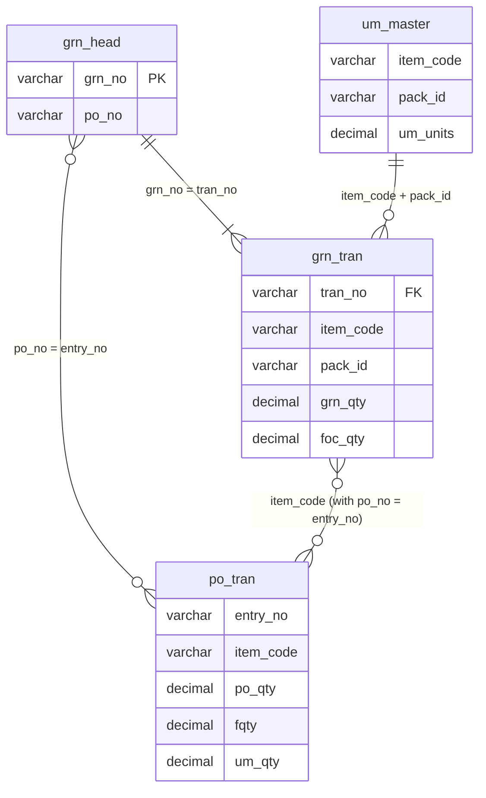
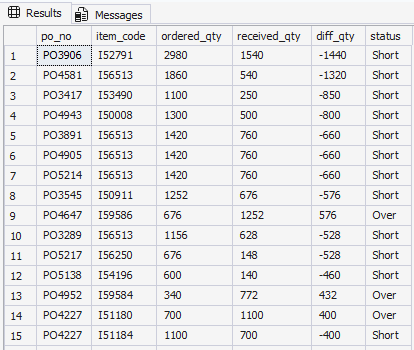
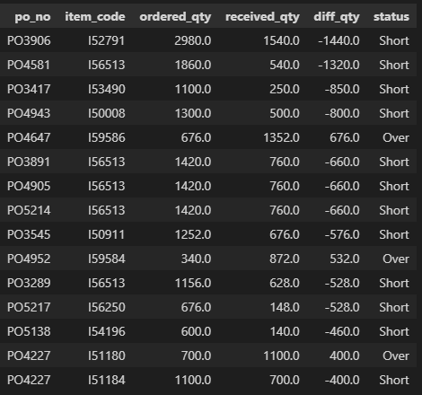

# PO, GRN and Price Variation Analysis using SQL and Python

**PO = Purchase Order, GRN = Goods Receipt Note**

SQL and pandas analysis of purchase orders, goods receipts and price variations to find receiving errors, cost price changes, negative margins and supplier delays.

## Dataset
- Data: anonymized data based on a hypermarket purchase and inventory system.
- The repository contains queries, scripts and result screenshots only, no data files.
- Database: SQL Server
- Tools: SQL and Python (pandas)

## Key assumptions
- All quantities are converted to **base units** using the pack conversion (`um_units`), so cartons and pieces compare correctly.
- Free quantity (FOC) is included on both the PO and GRN sides.

## Schema diagram

Only the tables and columns used by "GRN received more or less than PO qty" are shown.
---

## 01. GRN received more or less than PO qty

**Business impact:** Flags over-receipts (overpayment risk) and short receipts (stock-outs, supplier fill problems).

**Logic:**
- Ordered qty = (PO qty + free qty) x pack units
- Received qty = GRN qty x pack units + FOC qty
- All GRNs of a PO are added together, so partial deliveries are compared correctly

### SQL

**Query:** [01_grn_qty_mismatch.sql](queries/01_grn_qty_mismatch.sql)

**Result:**

### pandas

**Script:** [01_grn_qty_mismatch.py](pandas/01_grn_qty_mismatch.py)

**Result:**

Top 15 rows shown, sorted by largest difference. Total: 16,632 PO-item rows compared. The pandas result matches the SQL result (same row count and same Exact, Short and Over counts).